# DocScan: تحويل الوثائق المصوّرة إلى مستندات

DocScan turns phone photos of Arabic official letters and reports into documents on your office's header template.
Staff add the photos in order, read them with a free reader on the computer or an AI reader (with their own key),
check the text next to the photo, and produce the file as Word, PDF, ODT, PNG images or plain text.
Anything the reader was unsure of is highlighted in the file, with a note saying why.

It runs two ways: as a Windows program (an installer, no browser or server needed) or as a web app on an office server.

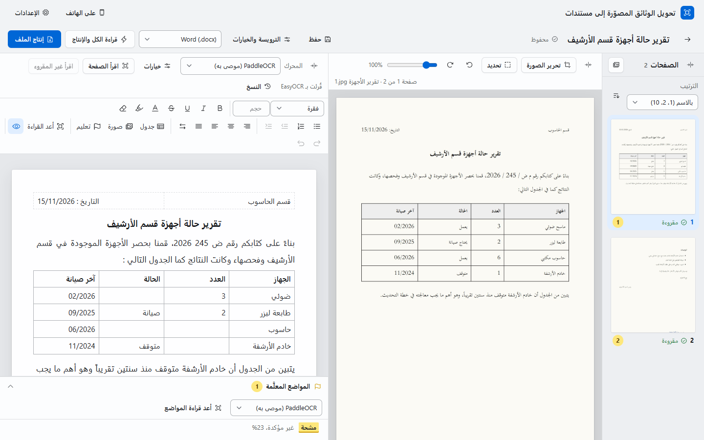

## What it does

- **Drafts** are saved as you work. The home list can be searched by document name, person or page count, and sorted by any column.
- **Pages** go in many at a time, or one at a time by pasting a copied picture (Ctrl+V). A picture pasted into the text goes
  into the document instead. Order pages by name (1, 2, 10), alphabetically, by photo date or as picked, and drag to reorder.
  Each photo can be rotated, straightened, cropped, brightened or turned gray, and the original stays so it can be restored.
- **Readers** are picked per page, and every new reading is kept as a version you can go back to or delete.
  The free ones run on the computer: PaddleOCR (the default), Nuqta (the most accurate for Arabic, but slower), Tesseract
  (fast, standard and best) and EasyOCR. Claude and Google Cloud Vision need the user's own key, which goes with each
  request and is never stored.
- The free readers keep the photo's layout. Tables with lines come out with each word in its cell, and so do tables printed
  without lines. A row with a part on each side ("الرقم ... التاريخ") stays one row. Bulleted and numbered lists come out as
  lists, even when the reader missed the bullet, and bold or centered lines become headings. Alignment is kept, and English
  pages run left to right.
- A screenshot of a dark screen is read as dark text on light, so a framed box does not become a table and red spellcheck
  lines are not taken for handwriting. Code and JSON keep their line breaks and indents. On an English page, Arabic words are
  read as Arabic and stay in their order.
- Handwriting, signatures and stamps are not guessed into the text. Each one becomes a highlighted marker in its place,
  linked to its spot on the photo. PaddleOCR drops digits inside Arabic lines, so Tesseract reads the page too, and any number
  PaddleOCR missed is put back and highlighted.
- Clicking a line of the text shows that line on the photo, the way a highlighted word does. The small panel can switch to
  the whole paragraph, or in a table to the cell or its row. The eye button in the toolbar turns this off and on.
- Any highlighted word, any line, paragraph or table cell, or every highlighted spot on a page can be **read again** with
  another reader. Its reading shows as a suggestion, and taking it replaces just that text and keeps its formatting.
- The **editor** works like a page in Word: bold, italic, underline, strikethrough, text and highlight colors, any text size,
  three heading levels, quotes, alignment, left-to-right paragraphs, and undo. Select any lines to make them a bulleted or
  numbered list, then indent them. Tables take their size from a grid or from typed numbers, and their rows, columns, lines and
  cell colors can all be changed. Pictures can be cut from the page photo (a logo, a chart, a signature): press تحديد on the
  photo, drag a box around the part, move it if needed, then copy it or put it in the text. A copied part pastes into any
  program at the photo's full resolution. The tools for the
  selected text, table or picture appear right above it, and clicking a highlighted word opens a small panel with its note,
  that spot of the photo, and the word ready to correct.
- The **workspace** puts pages, photo and text side by side. Drag the bars between them to resize, or fold any part into a
  thin rail. On a phone the three parts become tabs, the text tools fit in one row, and menus open from the bottom of the
  screen.
- The **output** uses the chosen header template (header, footer and page setup kept, `{{DATE}}` filled in), the document
  font and size, and real Word lists and headings. Highlighted text keeps its note, as a Word comment in `.docx` and `.odt` and
  as a numbered footnote in PDF and PNG. Formats: `.docx`, PDF, `.odt`, PNG (one image, or a `.zip` for several pages) and `.txt`.
- "قراءة الكل والإنتاج" reads every unread page and produces the file in **one click**.
- It works at any browser zoom, from the keyboard alone, and in light and dark themes (الإعدادات > المظهر: follow the system,
  light or dark), with 44 px touch targets on phones.

## Screenshots

The pages in these pictures are made-up test letters.

| | |
|---|---|
| 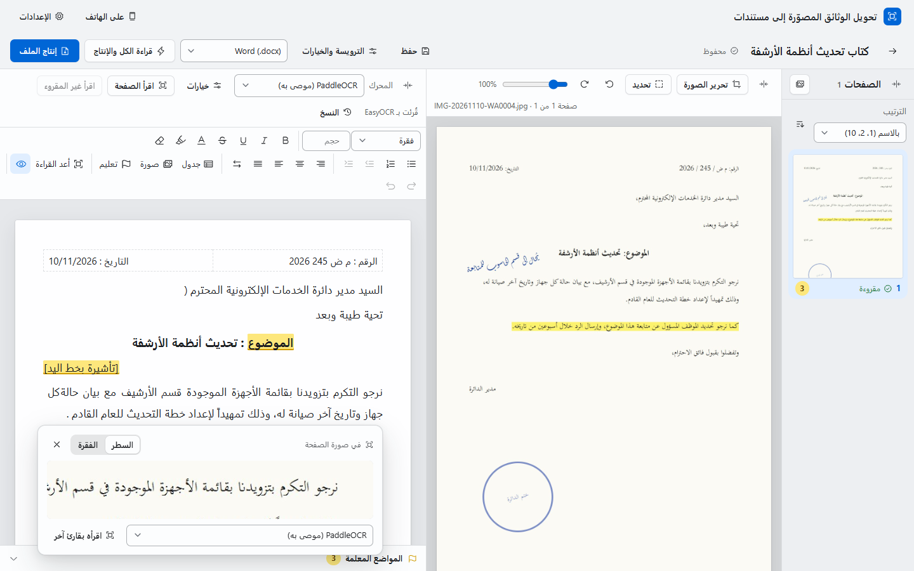 | 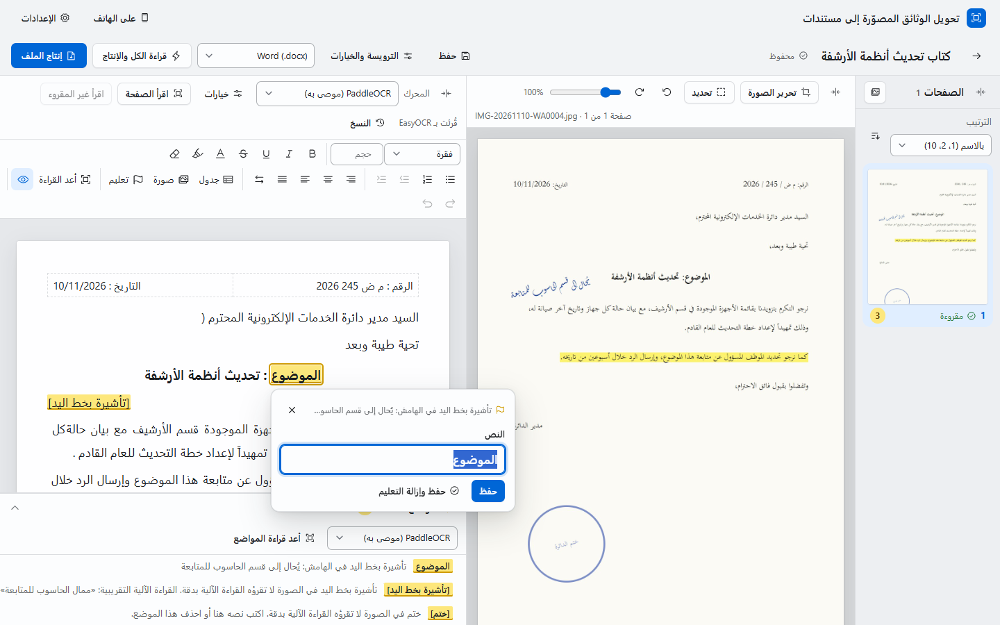 |
| Click a line to see it on the photo, and read it again with another reader. | Click a highlighted word to see why it was marked and correct it in place. |
| 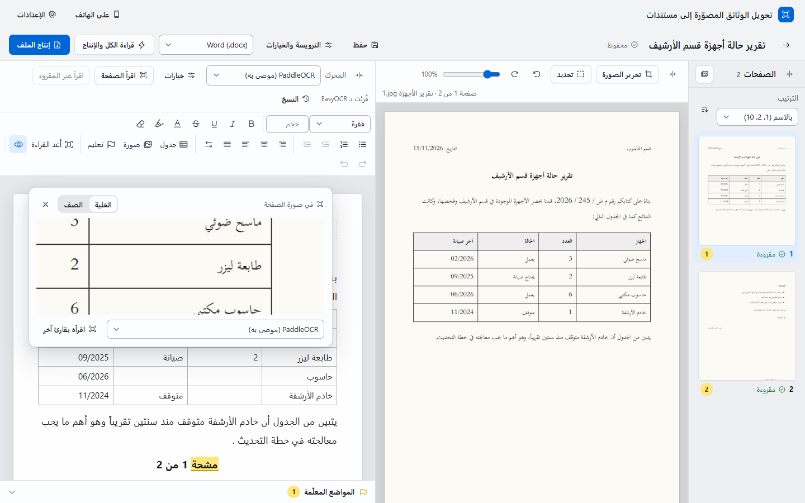 | 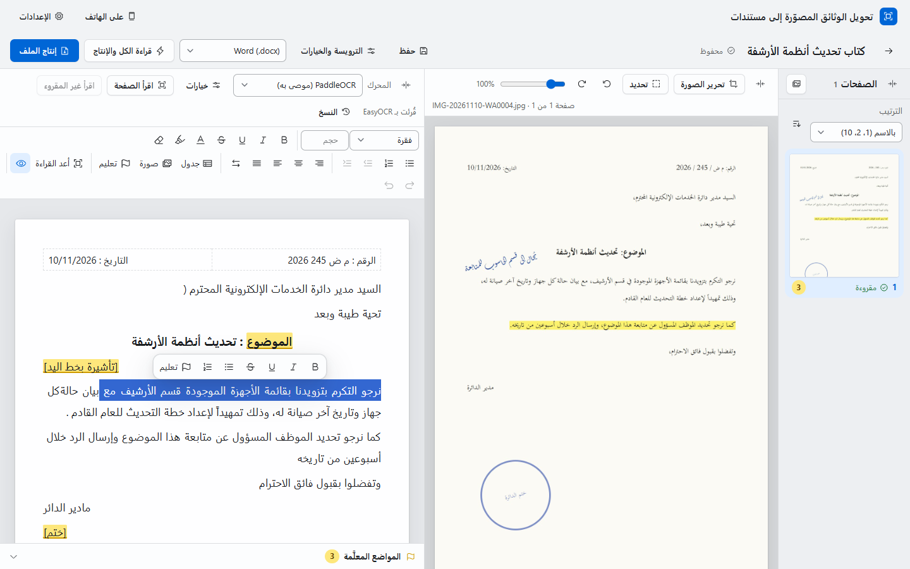 |
| Table cells have their own spot on the photo. | The tools for selected text appear right above it. |
| 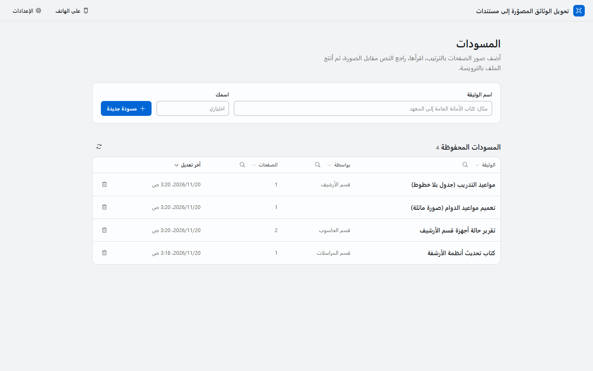 | 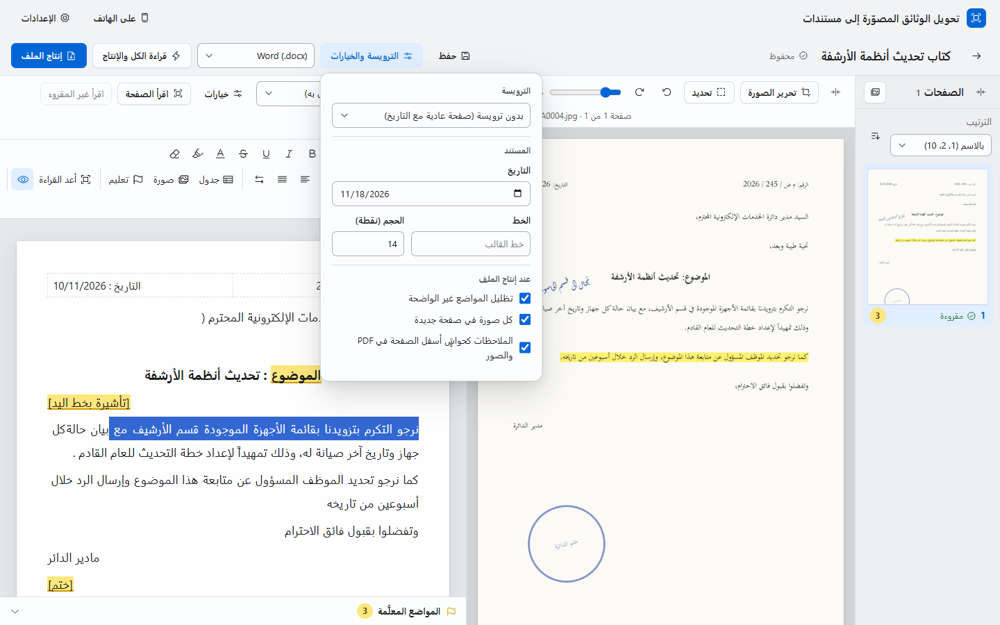 |
| Drafts can be searched by name, person or page count. | The template, the document's font and size, and what goes in the file. |
| 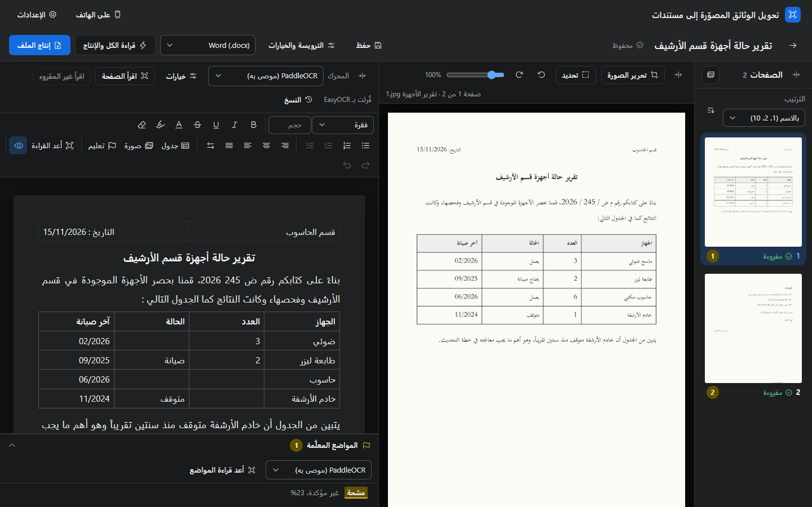 | 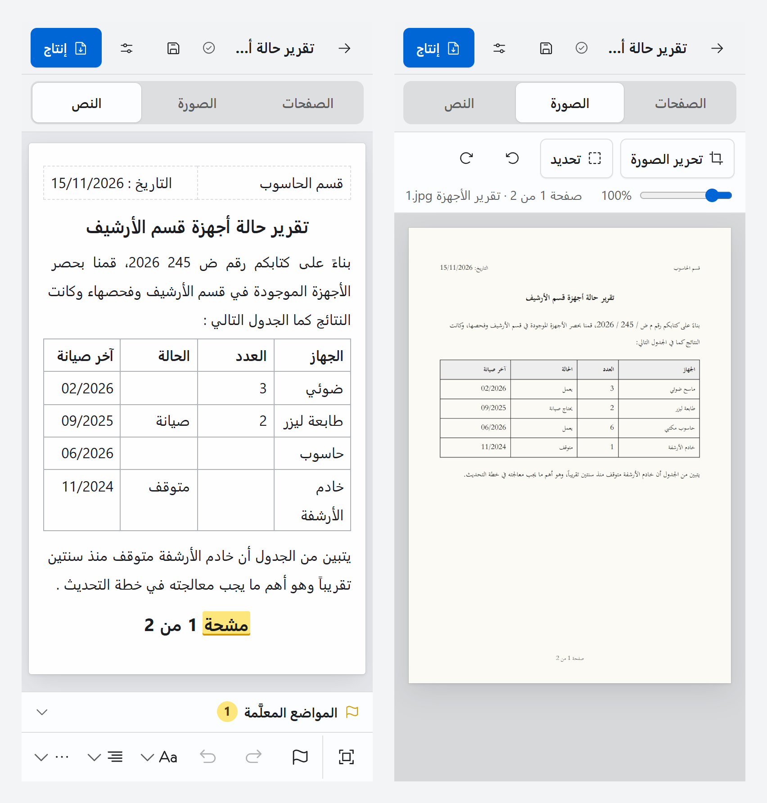 |
| The dark theme. | On a phone the pages, the photo and the text become tabs, with the text tools in one row at the bottom. |
| 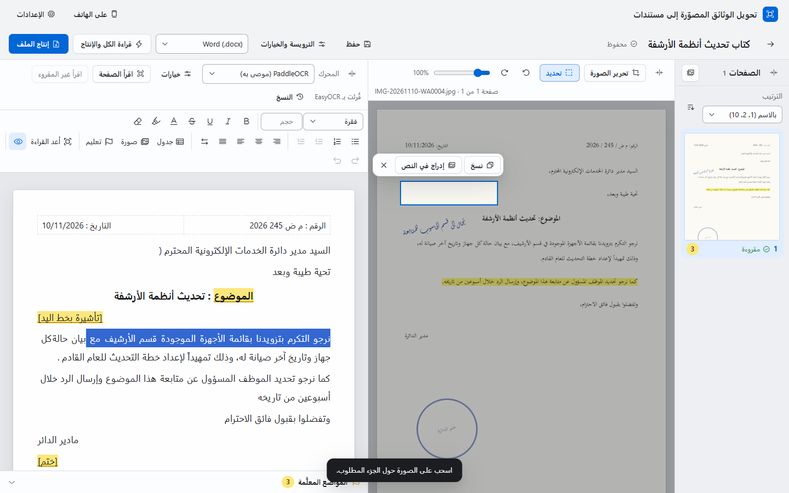 | 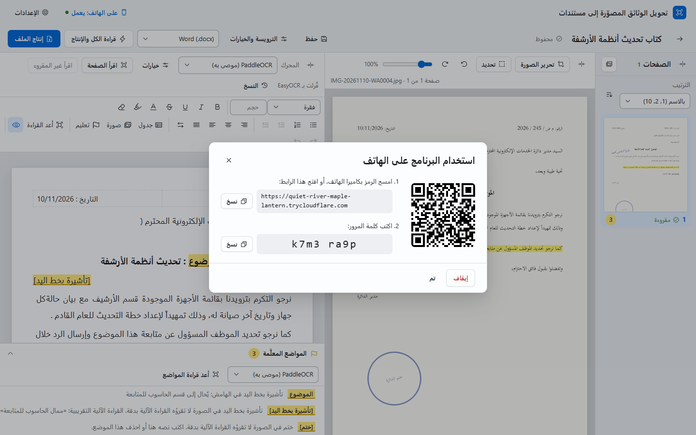 |
| Select part of the photo (a note in the margin, a stamp, a signature) to copy it or put it in the text. | Scan the code or open the link on a phone, then type the password. This link and password are made up. |

## Windows program

Download `DocScan-Setup-<version>.exe` from the [releases](../../releases) and run it. It installs for the current user
(no administrator rights) with PaddleOCR and Tesseract, and asks whether to add Nuqta and EasyOCR (about 2 GB, downloaded only
if chosen). If they were skipped, picking either one in the reader list, or الإعدادات > القرّاء الإضافيون, downloads them
from inside the program. The program opens in its own window; closing it ends it completely. Drafts are kept in `%LOCALAPPDATA%\DocScan`.
PDF, ODT and TXT need Microsoft Word or LibreOffice on the computer; Word files (`.docx`) always work.

At start, and from الإعدادات > عن البرنامج, the program checks this repository's latest release and offers to update
itself, with a list of what changed (ما الجديد؟). Without internet it says nothing at start.

To use it on a phone from anywhere, press على الهاتف in the top bar. It shows a link, a QR code for it and a password. The
phone works on the same drafts in its browser while the program stays open on the computer. The link and password are new
each time, five wrong passwords in a minute lock sign-in for the rest of that minute, and updates, readers and the link itself
are only controlled from the computer.

To build it yourself: `desktop\build.ps1 -Version 1.0.0 -Parts` (needs Tesseract in `C:\Program Files\Tesseract-OCR`),
then `iscc /DAppVersion=1.0.0 desktop\installer.iss` with Inno Setup 6. The GitHub workflow does both on a version tag
(`git tag v1.0.1 && git push --tags`) and publishes the release.

## Run as a server with Docker

```bash
docker build -t docscan .
docker run -d --name docscan -p 8000:8000 \
  -v docscan-data:/app/data -v docscan-templates:/app/templates \
  -e ADMIN_TOKEN=change-me \
  docscan
```

Open `http://SERVER:8000`. This image has Tesseract, LibreOffice and the AI readers (about 1.9 GB). For every free reader:

```bash
docker build -t docscan --build-arg WITH_EASYOCR=1 --build-arg WITH_PADDLE=1 --build-arg WITH_NUQTA=1 .
```

That image is about 8 GB. The readers' models are downloaded during the build, so the server reads pages without internet.
All of them run on the CPU. Give the container at least 6 GB of memory for Nuqta (3 GB without it). The first reading with a
reader takes 10 to 20 seconds while its model loads.

Measured on the test pages (5 synthetic pages, not real scans), seconds per page on a CPU:

| Reader | Text | Numbers kept | Ruled table cells | Lineless table cells | Seconds |
|---|---|---|---|---|---|
| PaddleOCR (with the Tesseract number check) | 92% | 41 of 43 | 20 of 20 | 12 of 12 | 4.8 |
| Tesseract (best) | 89% | 30 of 34 | 17 of 20 | 12 of 12 | 1.3 |
| EasyOCR | 91% | 33 of 34 | 15 of 20 | 11 of 12 | 7.9 |
| Nuqta | nearly every word and number right on the letter | | | | about 50 |

## Run without Docker (Ubuntu/Debian)

```bash
sudo apt install tesseract-ocr tesseract-ocr-ara tesseract-ocr-eng libreoffice-writer poppler-utils fonts-noto-core fonts-hosny-amiri
# Tesseract model folders (fast / standard / best)
for m in fast standard best; do sudo mkdir -p /opt/tessdata/$m; r=tessdata_$m; [ $m = standard ] && r=tessdata
  for l in ara eng; do sudo curl -fsSL -o /opt/tessdata/$m/$l.traineddata https://raw.githubusercontent.com/tesseract-ocr/$r/main/$l.traineddata; done; done
python3 -m venv .venv && . .venv/bin/activate
pip install -r server/requirements.txt
cd server && uvicorn main:app --host 0.0.0.0 --port 8000
```

Optional readers: `pip install paddlepaddle==3.3.1 paddleocr==3.7.0` (PaddleOCR),
`pip install torch torchvision --index-url https://download.pytorch.org/whl/cpu`, then `pip install easyocr` and
`pip install "transformers>=5.23" accelerate` (Nuqta). Without Docker they download their models the first time they read.

## Settings (environment variables)

| Variable | Default | Meaning |
|---|---|---|
| `APP_PASSWORD` | empty | If set, the whole app asks for this password (HTTP basic auth, any user name). |
| `ADMIN_TOKEN` | empty | If set, adding or removing header templates needs this token. |
| `ANTHROPIC_API_KEY` / `GOOGLE_VISION_API_KEY` | empty | Optional department key, used when a user has not entered their own. |
| `CLAUDE_MODELS` | `claude-sonnet-5-5,claude-opus-5-5,claude-haiku-5-5` | Models offered in the menu (the first is the default). |
| `TESSDATA_FAST` / `TESSDATA_STANDARD` / `TESSDATA_BEST` | `/opt/tessdata/{fast,standard,best}` | Tesseract model folders. |
| `LOW_CONFIDENCE` | `65` | Tesseract and Google words below this confidence are highlighted. |
| `BOX_ENGINE_LOW_CONFIDENCE` | `35` | The same for EasyOCR, PaddleOCR and Nuqta, which score lower. |
| `NUQTA_MODEL` | `SalahALHaismawi/Nuqta-Arabic-OCR-0.8B` | The Nuqta model on Hugging Face. |
| `MAX_OCR_JOBS` / `MAX_CONVERT_JOBS` | `2` / `2` | How many readings and conversions run at once. |
| `DOCSCAN_DATA` / `DOCSCAN_TEMPLATES` | `./data` / `./templates` | Where drafts, photos and templates are kept. |

## Header templates

A template is any `.docx` whose header and footer you want; its body is replaced by the content. Put `{{DATE}}` in the
header or footer to have the document date filled in. Add a template from the template list ("إضافة قالب جديد") or from
**الإعدادات**, or drop `name.docx` and `name.json` (`{"name": "...", "order": 1}`) into the templates folder. The lowest `order` is the default.

This repository ships only `plain.docx` (a page with the date at the top). Add your office letterhead after installing.

## Tests

```bash
cd server && python -m pytest tests -q   # layout from the photo: tables, lists, handwriting marks, numbers, headings
node --test web/js/*.test.js             # the Word file, and the editor's conversion to and from the page model
```

The text editor is Tiptap (MIT). It is bundled once into `web/vendor/tiptap.min.js` (`cd tools/editor && npm ci && npm run build`),
so the app itself needs no build step.

## Privacy

The free readers run on your computer or server, so photos never leave it. Choosing Claude or Google Vision sends that
page's photo to that company with the user's key. On a server, drafts and photos are visible to everyone who can open the
app, so keep it on the internal network and set `APP_PASSWORD`.

The Windows program also connects to GitHub. At start it asks this repository for its latest release, to offer updates,
and it downloads the installer or the optional readers from those releases only when the user chooses to. Apart from the
address that any web request carries, these requests include nothing about the user or their documents.

Using the program on a phone is off until the user turns it on. Then the pages and photos the phone opens pass, encrypted,
through Cloudflare's free tunnel service (the program downloads Cloudflare's `cloudflared.exe` for it the first time). The
link and its password are new each time, and stopping it, or closing the program, ends both.

## Code signing policy

The Windows installer will be signed for free through SignPath once the project's application is approved. Until
then, releases are unsigned. Signed releases carry this attribution: Free code signing provided by [SignPath.io](https://about.signpath.io),
certificate by [SignPath Foundation](https://signpath.org).

- Committers and reviewers: [eyasbzour](https://github.com/eyasbzour)
- Approvers: [eyasbzour](https://github.com/eyasbzour)

The signed file is the installer that this repository's GitHub workflow builds from the source code here, and each signed
release is approved by hand. The open-source components it bundles (Python, Tesseract, PaddleOCR and the libraries they
use) are included as their own projects publish them.

The program sends nothing to other computers unless the user asks it to, apart from the update check described under
[Privacy](#privacy).

## License

MIT, see [LICENSE](LICENSE). The bundled readers and libraries keep their own licenses (Tesseract, PaddleOCR and the Nuqta
model are Apache-2.0).
